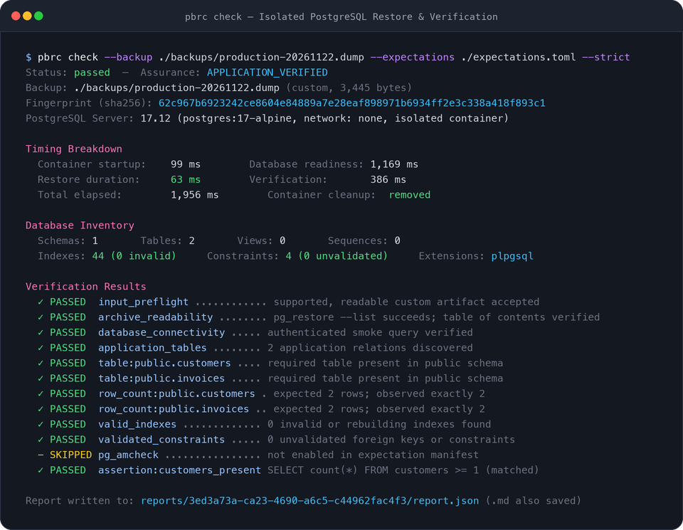
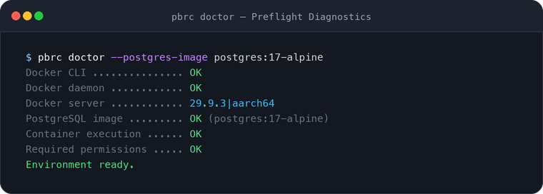
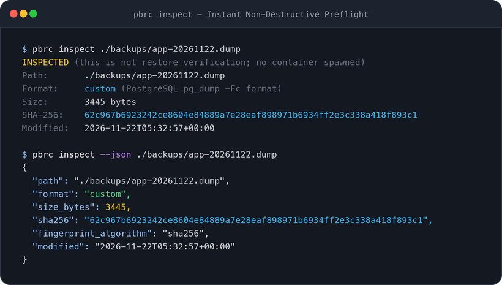
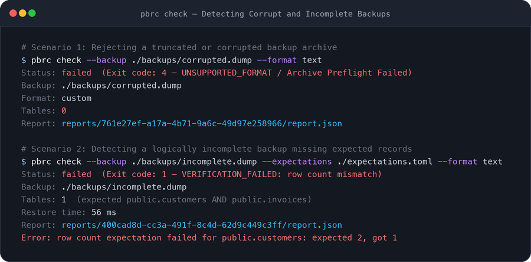
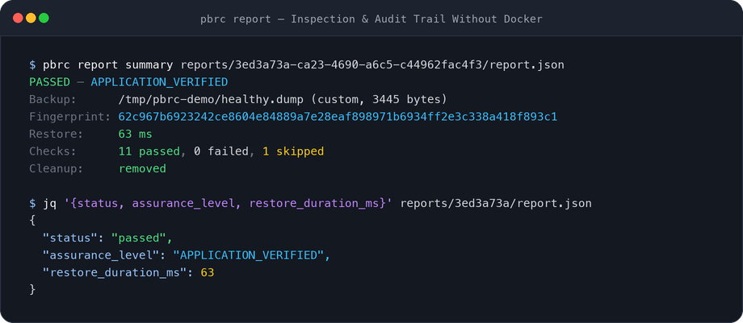

# PostgreSQL Backup Restore Checker (`pbrc`)

> Your PostgreSQL backup job reports success every night. But have you actually tried restoring the files?

`pbrc` restores logical PostgreSQL backups into fresh, isolated Docker containers, verifies the recovered schema and data against defined expectations, and outputs auditable JSON and Markdown evidence.

It provides verifiable proof about a test restore. It does not replace full production disaster recovery rehearsals, but it ensures your backups are physically readable, logically restorable, and structurally intact.



---

## The Problem

Most organizations monitor whether a backup file was written to disk or uploaded to S3. However, a file existing on disk does not prove that:

1. **The archive is readable:** Truncated writes, transfer corruption, or disk bit-rot can make archives unreadable.
2. **PostgreSQL can restore it:** Schema collisions, unsupported syntax, or version incompatibilities can abort `pg_restore` midway.
3. **The data is actually there:** A backup job might complete cleanly after dumping an empty database or failing to dump critical tables.
4. **Constraints and indexes are valid:** Corruption can leave indexes unusable or foreign keys unvalidated.
5. **Expected records exist:** Logical regressions might leave tables with 0 rows without failing the dump command.

`pbrc` automates test restorations in disposable, network-isolated environments to provide objective, repeatable evidence before disaster strikes.

---

## Key Features

- **Automated Disposable Restores:** Restores archives into isolated, project-owned PostgreSQL Docker containers on the `none` network with no host mounts, published ports, or socket access.
- **5 Supported Logical Formats:**
  - PostgreSQL Custom archive (`pg_dump -Fc`)
  - PostgreSQL Tar archive (`pg_dump -Ft`)
  - PostgreSQL Directory archive (`pg_dump -Fd`)
  - Plain SQL script (`pg_dump -Fp`)
  - Gzip-compressed plain SQL (`.sql.gz`) with streaming decompression limits
- **Multi-Version Testing:** Native support for PostgreSQL 16, 17, and 18 images (`postgres:XX-alpine`).
- **Expectation Manifests:** Declarative TOML manifests specifying required tables, exact/bounded row counts, required schemas/extensions, and custom read-only SQL assertions.
- **Structural Integrity Audits:** Automatic catalog checks for invalid or broken indexes, unvalidated constraints, and optional `pg_amcheck` verification.
- **Non-Destructive Inspection:** Instant `pbrc inspect` command checks archive format, size, modification time, and SHA-256 fingerprint without launching Docker.
- **Deterministic Artifact Fingerprinting:** Single-file SHA-256 hashing and directory tree hashing via `sha256-tree-v1` (sorted normalized paths, length, size, and file bytes).
- **Assurance Levels:** Every run classifies recoverability into `RESTORABLE`, `STRUCTURALLY_VERIFIED`, or `APPLICATION_VERIFIED`.
- **Auditable Evidence:** Generates structured `report.json` and human-readable `report.md` recording timing breakdowns, catalog inventories, check evaluations, and cleanup status.
- **CI & Script-Ready:** Strict exit codes (0–6), `--ci` mode, and offline `report` commands for automated verification pipelines.

---

## Visual Demonstration Gallery

### 1. Preflight Diagnostics (`pbrc doctor`)
Validates local Docker daemon communication, server architecture, target PostgreSQL image availability, container execution, and smoke query responsiveness:



### 2. Instant Archive Inspection (`pbrc inspect`)
Inspects archive format and computes cryptographic fingerprints without starting a container:



### 3. Detecting Corrupted & Incomplete Backups
Rejects truncated archives during preflight (exit code 4) and flags missing relations or row count discrepancies against expectations (exit code 1):



### 4. Offline Report Summaries (`pbrc report`)
Inspect saved audit reports directly in the terminal or consume JSON payloads without requiring Docker:



---

## Installation

### Prerequisites
- Stable Rust (1.80+ or 2024 edition)
- Docker Engine / Docker Desktop running locally
- PostgreSQL Docker image (defaults to `postgres:17-alpine`)

### From Source
```sh
# Clone repository
git clone https://github.com/ranajahanzaib/postgres-backup-restore-checker.git
cd postgres-backup-restore-checker

# Build and install release binary
cargo install --path .
```

Verify the installation:
```sh
pbrc --version
pbrc doctor
```

---

## Quickstart

Run the built-in self-test demo to create and verify real PostgreSQL backups across all supported formats:

```sh
# Run end-to-end demo with healthy, corrupt, and incomplete scenarios
pbrc demo --out ./demo-output

# Inspect a backup file without restoring
pbrc inspect ./demo-output/healthy.dump

# Perform a verified restore of a backup
pbrc check --backup ./demo-output/healthy.dump --postgres-major 17

# Verify against strict expectations
pbrc check \
  --backup ./demo-output/healthy.dump \
  --expectations ./demo-output/expectations.toml \
  --strict \
  --format text
```

---

## CLI Command Reference

### `pbrc check`
Restores a backup into an isolated container and validates it.

```sh
# Basic check with specific PostgreSQL major version
pbrc check --backup ./backups/app.dump --postgres-major 17

# Select the newest backup from a directory using a glob pattern
pbrc check --directory ./backups --latest --glob 'prod-*.dump'

# Strict verification with expectation manifest and JSON output
pbrc check \
  --backup ./backups/app.dump \
  --expectations ./examples/expectations.toml \
  --strict \
  --format json

# Parallel restore with resource constraints
pbrc check \
  --backup ./backups/app.dump \
  --jobs 4 \
  --memory-limit 4g \
  --cpu-limit 2.0 \
  --timeout 300
```

#### Key Options for `check`:
| Flag | Description | Default |
|------|-------------|---------|
| `--backup PATH` | Direct path to a backup file or directory archive | None |
| `--directory DIR` | Directory containing backups (requires `--latest`) | None |
| `--latest` | Select newest file in `--directory` by modification time | `false` |
| `--glob PATTERN` | Wildcard pattern to match candidates in `--directory` | `*` |
| `--postgres-major 16\|17\|18` | Selects standard `postgres:<major>-alpine` image | `17` |
| `--postgres-image IMAGE` | Custom Docker image (e.g. `postgres:17.2-bookworm`) | `postgres:17-alpine` |
| `--expectations PATH` | Path to expectations TOML manifest | None |
| `--strict` | Fails unless application expectations, valid indexes, and validated constraints pass | `false` |
| `--format text\|json\|markdown`| Terminal output format | `text` |
| `--report-dir DIR` | Destination directory for audit reports | `./reports` |
| `--jobs N` | Parallel `pg_restore` workers (custom & directory formats) | `1` |
| `--single-transaction` | Execute restore inside a single transaction | `false` |
| `--memory-limit SIZE` | Docker container memory constraint (e.g. `2g`, `512m`) | `2g` |
| `--cpu-limit CORES` | Docker container CPU constraint (e.g. `2.0`, `1.5`) | `2.0` |
| `--expected-sha256 HEX` | Pre-verify backup SHA-256 before restoration | None |
| `--keep-on-failure` | Retain temporary container if restore fails for manual debugging | `false` |

### `pbrc inspect`
Inspects the artifact format, file size, timestamps, and cryptographic fingerprint without Docker:

```sh
pbrc inspect ./backups/app.dump
pbrc inspect --json ./backups/app.dump
```

### `pbrc doctor`
Checks Docker daemon connectivity, engine version, container launch permissions, and PostgreSQL responsiveness:

```sh
pbrc doctor
pbrc doctor --postgres-image postgres:16-alpine
```

### `pbrc report`
Reads previously saved reports without Docker:

```sh
# Print full Markdown report
pbrc report show ./reports/<run-id>/report.json

# Print concise one-line summary
pbrc report summary ./reports/<run-id>/report.json
```

### `pbrc cleanup`
Inspects and removes project-owned test containers:

```sh
# Preview project containers older than 24 hours
pbrc cleanup --stale

# Remove stale containers
pbrc cleanup --stale --yes

# Clean up a specific run container
pbrc cleanup --run-id <run-id> --yes
```

---

## Defining Expectations

Declarative manifests allow teams to enforce schema and data integrity policies. See [examples/expectations.toml](examples/expectations.toml).

```toml
[metadata]
name = "Production Core Schema"
description = "Ensures customer records, orders, and payment constraints are restorable"

# Require relations to exist in the database
tables = [
  "public.customers",
  "public.invoices",
]

# Enforce row count policies
[row_counts]
"public.customers" = 250
"public.invoices" = 730

# Detailed bounds for dynamic tables
[[tables]]
name = "public.audit_logs"
required = true
min_rows = 1000
max_rows = 500000

# Structural validation policies
[verification]
require_nonempty_database = true
require_valid_indexes = true
require_validated_constraints = true
run_amcheck = false
required_schemas = ["public"]
required_extensions = ["plpgsql"]

# Trusted read-only assertions
[[queries]]
id = "active_tenant_count"
description = "Verify at least one active tenant account exists"
sql = "SELECT count(*) FROM public.customers WHERE active = true"
min_integer = 1
required = true
```

---

## Container Isolation & Security Model

`pbrc` treats backup archives as potentially untrusted input:

- **Isolated Container:** Every restore runs inside a freshly provisioned container using `template0` as the database template.
- **Zero Network:** Containers run with `--network none`. No external network ingress or egress is permitted.
- **No Host Mounts:** No filesystem volumes or host Docker sockets are mounted into the container.
- **Resource Constraints:** Enforced CPU limits (`--cpus`) and memory limits (`--memory`) prevent resource starvation.
- **Restricted Inspection Role:** SQL assertions run under a dedicated unprivileged `pbrc_verify` role created with read-only permissions inside the isolated database.
- **Deterministic Cleanup:** Containers are labeled with `io.pbrc.managed=true` and `io.pbrc.run=<id>` and removed automatically upon exit, even on interruption (SIGINT/SIGTERM).

---

## Exit Codes

`pbrc` returns structured, predictable exit codes suitable for CI/CD and automation scripts:

| Exit Code | Classification | Meaning |
|:---------:|----------------|---------|
| **0** | `PASSED` | Restore succeeded and all configured expectations passed. |
| **1** | `VERIFICATION_FAILED` | Restore succeeded, but expectation checks, row counts, or structural constraints failed. |
| **2** | `INVALID_CONFIGURATION` | Invalid CLI arguments, conflicting options, or malformed expectation TOML. |
| **3** | `DOCKER_UNAVAILABLE` | Docker CLI missing, daemon unreachable, or container failed to start. |
| **4** | `UNSUPPORTED_INPUT` | Backup file missing, unreadable, empty, corrupted, or unsupported archive format. |
| **5** | `TIMEOUT` | Operation timed out or was interrupted by signal (SIGINT/SIGTERM). |
| **6** | `INTERNAL_ERROR` | Unexpected internal runtime failure. |

---

## CI / CD Integration

Use `pbrc` in GitHub Actions or scheduled cron pipelines to automatically verify daily database dumps:

```yaml
name: Verify PostgreSQL Backup Recovery

on:
  schedule:
    - cron: '0 4 * * *' # Run daily at 04:00 UTC
  workflow_dispatch:

jobs:
  verify-restore:
    runs-on: ubuntu-latest
    steps:
      - name: Check out repository
        uses: actions/checkout@v4

      - name: Set up Rust
        uses: dtolnay/rust-toolchain@stable

      - name: Install pbrc
        run: cargo install --path .

      - name: Verify Docker Environment
        run: pbrc doctor --postgres-image postgres:17-alpine

      - name: Download Nightly Backup Artifact
        run: |
          # Fetch your backup file from protected object storage
          mkdir -p backups
          aws s3 cp s3://company-backups/postgres/latest.dump ./backups/latest.dump

      - name: Verify Recovery
        run: |
          pbrc check \
            --backup ./backups/latest.dump \
            --expectations ./examples/expectations.toml \
            --strict \
            --ci \
            --format markdown > recovery-report.md

      - name: Archive Recovery Report
        if: always()
        uses: actions/upload-artifact@v4
        with:
          name: recovery-evidence
          path: |
            reports/
            recovery-report.md
```

---

## Development & Testing

Ensure Xcode command line tools and Docker are available:

```sh
# Run code formatting check
cargo fmt --all -- --check

# Run linter
cargo clippy --all-targets -- -D warnings

# Execute unit and integration tests
cargo test --all-targets

# Compile optimized release binary
cargo build --release
```

---

## Contributing

See [CONTRIBUTING.md](CONTRIBUTING.md) and [CODE_OF_CONDUCT.md](CODE_OF_CONDUCT.md) for contribution guidelines.

## License & Custom Work

[](mailto:work@withrana.com) [](https://www.linkedin.com/in/workwithrana)
[](https://www.upwork.com/freelancers/~01bbcf6edb91a8df5f)
[](https://contra.com/ranajahanzaib/)

**License:** MIT, see [LICENSE](LICENSE). Free for personal and commercial use.

**Author:** Rana Jahanzaib

**Need this built for your stack?** Email me what you're working on: work@withrana.com
